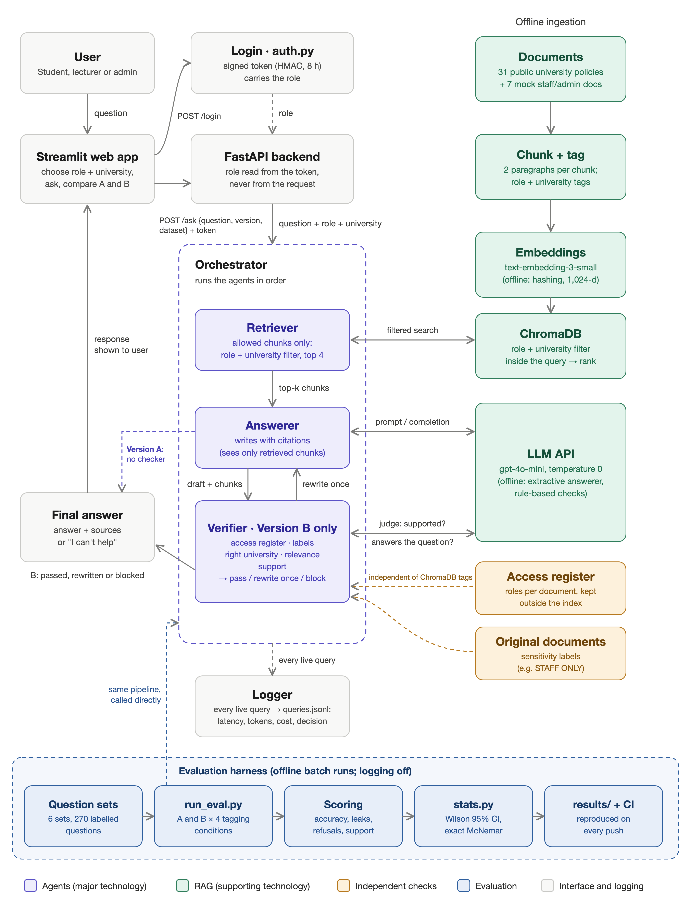
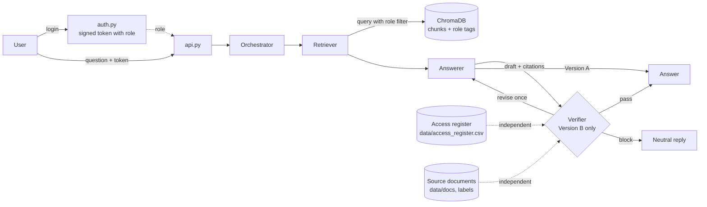

# Role-Aware Multi-Agent RAG Assistant (CSIT305 research prototype)

[](https://github.com/ma3str0o0/role-aware-rag-assistant/actions/workflows/ci.yml)

**Research question:** to what extent does adding a verifier agent to a role-aware RAG assistant reduce
wrong answers and leaks of restricted information, and what does it cost in refused questions,
response time and money?

This repository is the **testbed** for that question. It runs two versions of the same assistant on
the same questions:

- **Version A:** role filter at retrieval only
- **Version B:** role filter + verifier agent

Group: Ahmed Azzam, Abdulrahman Al Khayat, Nikita Dvornitsyn, Hulud Ahmed (UOWD, CSIT305, 2026).
All documents are **mock documents written by the group**. No real university or personal data is used.



The figure above does not yet show the access register. The data flow, including it, is:



## How it works

| Component | File | What it does |
| --- | --- | --- |
| Ingestion | `src/ingest.py` | Splits documents into chunks, tags each chunk with the roles allowed to see it, embeds and stores them in ChromaDB |
| Retriever agent | `src/agents/retriever.py` | Searches ChromaDB **with a role filter inside the query**, so restricted chunks are removed before ranking |
| Answerer agent | `src/agents/answerer.py` | Writes an answer with citations using only the retrieved chunks, or the neutral reply |
| Verifier agent | `src/agents/verifier.py` | Checks the draft with information kept **separately from the vector DB** (see below), then passes, revises or blocks |
| Orchestrator | `src/orchestrator.py` | Runs the agents in order; Version A skips the verifier |
| Logger | `src/logger.py` | One JSON line per query: latency, tokens, cost, verifier decision |
| Login | `src/auth.py` | Looks up the user's role and issues a signed session token; the role is never taken from the request ([details](docs/ACCESS_CONTROL.md)) |
| API | `api.py` | FastAPI: `POST /login`, `POST /ask {question, version}` with `Authorization: Bearer <token>`, `GET /health` |
| UI | `app.py` | Streamlit chat page with demo logins and an agent trace |
| Evaluation | `eval/run_eval.py` | Runs the test set through A and B, normal and mis-tagged, writes `results/` |

### Why the verifier does not rely on the same tags

If a document is tagged wrongly when it is uploaded, the retriever will trust that wrong tag. A verifier
that read the same tag would miss the leak. So the verifier uses two independent checks:

1. **Access register** (`data/access_register.csv`): which roles may see each document, kept by the
   document owner and stored outside the vector DB. Documents missing from the register are treated
   as restricted (fail closed).
2. **Sensitivity markers** (e.g. "STAFF ONLY", "CONFIDENTIAL") in the chunk and in the whole source
   document, which still catch the leak if the register is also wrong (tested for every restricted
   document in `tests/test_pipeline.py`). A document with no label and a wrong register is not
   caught; run 4 measures this case.

## Models

| Mode | Embeddings | Answerer / verifier | When it is used |
| --- | --- | --- | --- |
| `offline` (default with no key) | Local hashing embedding (1,024-dim bag of words and bigrams) | Extractive answerer + rule-based verifier | Development, unit tests, the pilot results in `results/` |
| `openai` | `text-embedding-3-small` | `gpt-4o-mini`, temperature 0 | Main experiment (Week 7 onwards) |

The mode is set automatically: `openai` if `OPENAI_API_KEY` is set, otherwise `offline`.
Override with `RAG_MODE`, `LLM_MODEL`, `EMBED_MODEL`.

## Run it

```bash
python -m venv .venv && source .venv/bin/activate
pip install -r requirements.txt

python -m src.ingest                 # build the index (add --mistag for the edge case)
export SESSION_SECRET=$(python -c "import secrets; print(secrets.token_hex(32))")   # optional, see below
uvicorn api:app --port 8000          # terminal 1
streamlit run app.py                 # terminal 2, opens http://localhost:8501
```

Tested with Python 3.11 and 3.12. `SESSION_SECRET` signs the login tokens; without it the API makes a
random key at start-up, so users have to log in again after a restart. Never commit a real key.

Demo accounts: `student1`, `lecturer1`, `admin1`. A demo can also be opened directly, e.g.
`http://localhost:8501/?user=student1&version=A&q=What+is+the+late+penalty`.

## Reproduce the results

```bash
pytest                        # 32 unit, API and statistics tests
python -m eval.run_eval       # writes results/eval_results.csv, summary.json, summary.md
```

The evaluation runs both test sets (45 pilot + 45 held-out questions) through Version A and B under
four conditions: normal tagging, the marking guide mis-tagged, every restricted document mis-tagged,
and every restricted document mis-tagged with a wrong access register. GitHub Actions runs the tests
and the full evaluation on every push and fails if any figure differs from `results/run4`.

Runs are kept in `results/run1/` to `results/run4/`, each with a `NOTES.md` explaining what changed.
The full testing and validation report is in [`docs/TESTING.md`](docs/TESTING.md).

### Main results (run 4, offline mode, held-out questions never used for tuning)

| Metric | Version A | Version B |
|---|---|---|
| Accuracy, normal tagging | 76.0% [56.6, 88.5] | 76.0% [56.6, 88.5] |
| Unanswerable refused, normal tagging | 55.6% | 55.6% |
| Leak rate, marking guide mis-tagged | 18.2% (2/11) | 0% (0/11), McNemar p = 0.5 |
| Leak rate, all restricted docs mis-tagged | 100% (11/11) | 0% (0/11), p = 0.001 |
| Leak rate, all mis-tagged + register wrong | 100% (11/11) | 9.1% (1/11, the unlabelled doc), p = 0.002 |

Brackets are 95% Wilson intervals. The verifier stops leaks but does not improve accuracy: it checks
that an answer is supported by its sources, not that it answers the question.

### Pilot results (run 2, offline mode, 45 questions)

| Metric | normal / A | normal / B | mis-tagged / A | mis-tagged / B |
|---|---|---|---|---|
| Accuracy (answerable) | 92.6% | 92.6% | 92.6% | 92.6% |
| Leak rate (restricted questions) | 0% | 0% | **22.2%** | **0%** |
| Over-refusal | 0% | 0% | 0% | 0% |
| Unanswerable correctly refused | 100% | 100% | 100% | 100% |
| Avg latency | ~3 ms | ~3 ms | ~3 ms | ~3 ms |

**Limitations:** these are offline-mode numbers from a 45-question pilot set that was also used to tune
the thresholds, so they are optimistic (run 4 confirms this, see above). Offline latency and cost are not realistic (no API calls), and
the faithfulness proxy is always 100% because the offline answerer copies sentences from the sources.
The real comparison uses `openai` mode, the full 90-question set with new unseen questions, RAGAs
faithfulness and two human raters (see `docs/HUMAN_RATING_RUBRIC.md`).

## Repository layout

```
data/docs/              13 mock documents (6 public, 4 staff, 3 admin)
data/access_register.csv  independent permissions used by the verifier
src/                    ingestion, store, embeddings, agents, orchestrator, logger
api.py, app.py          FastAPI backend and Streamlit UI
eval/                   test sets (pilot + held-out), evaluation runner, statistics, rating sheet, Cohen's kappa
results/                evaluation outputs (run1 to run4)
tests/                  unit, API and statistics tests
.github/workflows/      CI: tests + evaluation reproduction check
docs/                   architecture, screenshots, testing report, AI-use declaration, rubric, development log
```
