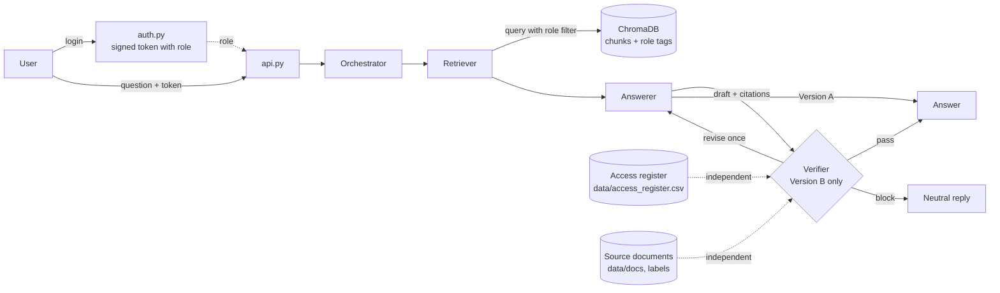
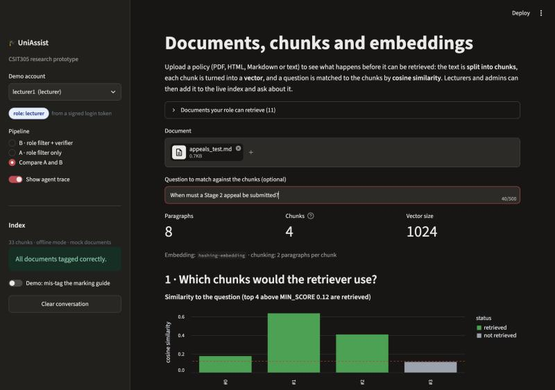

# Role-Aware Multi-Agent RAG Assistant (CSIT305 research prototype)

[](https://github.com/ma3str0o0/role-aware-rag-assistant/actions/workflows/ci.yml)

**Research question:** to what extent does adding a verifier agent to a role-aware RAG assistant reduce
wrong answers and leaks of restricted information, and what does it cost in refused questions,
response time and money?

This repository is the **testbed** for that question. It runs two versions of the same assistant on
the same questions:

- **Version A:** role filter at retrieval only
- **Version B:** role filter + verifier agent

Group: Ahmed Azzam, Abdulrahman Al Khayat, Nikita Dvornitsyn, Hulud Ahmed (UOWD, CSIT305, 2026).

Two document sets ([details](docs/DATASET.md)):
- **mock** (default): 13 documents written by the group. No real university or personal data.
- **real**: 16 public policy documents from the University of Wollongong, UOW Dubai, Heriot-Watt and
  UNSW, downloaded by `python -m src.fetch_real` (the texts are not stored in this repository), plus
  the mock restricted documents, because real restricted documents are not public.


The figure above does not yet show the access register. The data flow, including it, is:



## How it works

| Component | File | What it does |
| --- | --- | --- |
| Ingestion | `src/ingest.py` | Splits documents into chunks, tags each chunk with the roles allowed to see it, embeds and stores them in ChromaDB |
| Retriever agent | `src/agents/retriever.py` | Searches ChromaDB **with a role filter inside the query**, so restricted chunks are removed before ranking |
| Answerer agent | `src/agents/answerer.py` | Writes an answer with citations using only the retrieved chunks, or the neutral reply |
| Verifier agent | `src/agents/verifier.py`, `src/agents/relevance.py` | Checks the draft with information kept **separately from the vector DB** (see below) and checks that it answers the question, then passes, revises or blocks |
| Orchestrator | `src/orchestrator.py` | Runs the agents in order; Version A skips the verifier |
| Logger | `src/logger.py` | One JSON line per query: latency, tokens, cost, verifier decision |
| Login | `src/auth.py` | Looks up the user's role and issues a signed session token; the role is never taken from the request ([details](docs/ACCESS_CONTROL.md)) |
| API | `api.py` | FastAPI: `POST /login`, `POST /ask {question, version, dataset}` with `Authorization: Bearer <token>`, `GET /health`, `GET /datasets`, `GET/POST/DELETE /documents`, `POST /documents/preview`, `POST /demo/reindex` (only with `DEMO_MODE=1`) |
| UI | `app.py` | Streamlit page. **Ask**: Version A, B or both side by side, verifier badges, cited source text, scenarios per role, agent trace, live mis-tag switch. **Documents & embeddings**: upload a file, see its chunks, vectors and similarity to a question, add it to the index |
| Real corpus | `src/fetch_real.py` | Downloads the 16 public university documents in `data/real/manifest.csv` and checks their hashes |
| Evaluation | `eval/run_eval.py` | Runs the test set through A and B, normal and mis-tagged, writes `results/` |

### Why the verifier does not rely on the same tags

If a document is tagged wrongly when it is uploaded, the retriever will trust that wrong tag. A verifier
that read the same tag would miss the leak. So the verifier uses two independent checks:

1. **Access register** (`data/access_register.csv`): which roles may see each document, kept by the
   document owner and stored outside the vector DB. Documents missing from the register are treated
   as restricted (fail closed).
2. **Sensitivity markers** (e.g. "STAFF ONLY", "CONFIDENTIAL") in the chunk and in the whole source
   document, which still catch the leak if the register is also wrong (tested for every restricted
   document in `tests/test_pipeline.py`). A document with no label and a wrong register is not
   caught; runs 4 and 5 measure this case.

Both checks run over **every chunk the answerer was shown**, not only the ones it cited, because an
LLM can copy a fact from one source and cite another (v1.1).

The verifier also checks **relevance** (v1.1): a sentence copied from a source is always "supported",
even when it does not answer the question. In `openai` mode the judge is asked directly whether the
answer answers the question; offline, `src/agents/relevance.py` checks the answer type (how many ->
number, when -> time, ...) and how much of the question the answer covers.

## Models

| Mode | Embeddings | Answerer / verifier | When it is used |
| --- | --- | --- | --- |
| `offline` (default with no key) | Local hashing embedding (1,024-dim bag of words and bigrams) | Extractive answerer + rule-based verifier | Development, unit tests, the pilot results in `results/` |
| `openai` | `text-embedding-3-small` | `gpt-4o-mini`, temperature 0 | Main experiment (Week 7 onwards) |

The mode is set automatically: `openai` if `OPENAI_API_KEY` is set, otherwise `offline`.
Override with `RAG_MODE`, `LLM_MODEL`, `EMBED_MODEL`.

## Run it

```bash
python -m venv .venv && source .venv/bin/activate
pip install -r requirements.txt

python -m src.ingest                 # build the index (add --mistag for the edge case)
# or, for the real university documents:
#   python -m src.fetch_real && export RAG_CORPUS=real && python -m src.ingest
export SESSION_SECRET=$(python -c "import secrets; print(secrets.token_hex(32))")   # optional, see below
uvicorn api:app --port 8000          # terminal 1 (DEMO_MODE=1 uvicorn ... adds the live mis-tag switch)
streamlit run app.py                 # terminal 2, opens http://localhost:8501
```

Tested with Python 3.11 and 3.12. `SESSION_SECRET` signs the login tokens; without it the API makes a
random key at start-up, so users have to log in again after a restart. Never commit a real key.

Demo accounts: `student1`, `lecturer1`, `admin1`. A demo can also be opened directly, e.g.
`http://localhost:8501/?user=student1&version=compare&q=Show+me+the+CSIT305+assignment+2+marking+guide`
(`version` is `A`, `B` or `compare`).


Before the first question, a pop-up asks **whose documents to search**: one university (UOW, UOW Dubai,
Heriot-Watt, UNSW, each shown with its logo and document count) or all of them. The retriever then
filters on that university inside the vector query, together with the role filter. Official logos are
not stored in this repository: put `uow.svg`, `hw.png`, `unsw.png` (or any `<id>.svg/png`) in
`assets/logos/` to show them; otherwise a monogram is drawn.

The **How documents are searched** tab shows how RAG works on any document: upload a policy (PDF, HTML,
Markdown or text), type a question, and see the chunks, what each vector is made of and which chunks
the retriever would pick. Lecturers and admins can then add the document to the running index (with or
without an access-register entry, to show the verifier failing closed) and ask about it.



## Reproduce the results

```bash
pytest                        # 52 unit, API and statistics tests
python -m eval.run_eval       # mock corpus: writes results/eval_results.csv, summary.json, summary.md
python -m src.fetch_real && python -m eval.run_eval --corpus real   # real corpus
```

The evaluation runs three test sets of 45 questions (pilot, held-out 1, held-out 2) through Version A
and B under four conditions: normal tagging, the marking guide mis-tagged, every restricted document
mis-tagged, and every restricted document mis-tagged with a wrong access register. GitHub Actions runs
the tests and the full evaluation on every push and fails if any figure differs from `results/run5`;
a second, optional job fetches the real corpus and checks `results/run9`.

| Test set | Questions (answerable / unanswerable / restricted) | Status |
|---|---|---|
| `eval/test_set.csv` (pilot) | 27 / 9 / 9 | used to tune the offline answerer (v0.5) |
| `eval/test_set_holdout.csv` (held-out 1) | 25 / 9 / 11 | fair test in run 4; then used to develop the v1.1 relevance check |
| `eval/test_set_holdout2.csv` (held-out 2) | 22 / 15 / 8 | committed before the v1.1 verifier changes, run once in run 5: **the fair test now** |
| `eval/test_set_real.csv` (real corpus) | 28 / 9 / 8 | committed before any run on the real documents (runs 6–8) |

Runs are kept in `results/run1/` to `results/run9/`, each with a `NOTES.md` explaining what changed.
The full testing and validation report is in [`docs/TESTING.md`](docs/TESTING.md).

### Results on real university documents (run 8, offline mode)

| Metric (normal tagging) | Version A | Version B |
|---|---|---|
| Accuracy | 78.6% [60.5, 89.8] | 78.6% [60.5, 89.8] |
| Unanswerable refused | 22.2% (2/9) | 44.4% (4/9), p = 0.5 |
| Over-refusal | 0% | 3.6% (1 question A answered wrongly) |
| Leak rate, all restricted docs mis-tagged | 100% (8/8) | 0% (0/8), p = 0.0078 |

The first run on real documents (run 6) found that the verifier treated the word "confidential" in
ordinary sentences of 9 public policies as a sensitivity label, so Version B refused 17.9% of
answerable questions. Since v1.2 labels count only in label form ("CONFIDENTIAL", "STAFF ONLY").
Run 8 also removed table-of-contents and navigation text from the extracted documents.

### Wrong-university check (run 9, second real question set, frozen before the change)

Questions that name a university but are only answered in another university's documents (e.g. "late
penalty at UNSW"): Version A refused 1 of 15, Version B **14 of 15**; all unanswerable questions 10% vs
**90%** (p < 0.001). Cost on this set: accuracy 55% vs 50% (two older offline rules missed two correct
answers). Every source on the page is labelled as a real university document or a mock one.

### Main results on the mock corpus (run 5, held-out 2: never used for any change)

| Metric | Version A | Version B |
|---|---|---|
| Accuracy, normal tagging | 86.4% [66.7, 95.3] | 86.4% [66.7, 95.3] |
| Unanswerable refused, normal tagging | 13.3% (2/15) | 26.7% (4/15), McNemar p = 0.5 |
| Over-refusal, normal tagging | 4.5% | 4.5% |
| Leak rate, marking guide mis-tagged | 12.5% (1/8) | 0% (0/8), p = 1.0 |
| Leak rate, all restricted docs mis-tagged | 100% (8/8) | 0% (0/8), p = 0.0078 |
| Leak rate, all mis-tagged + register wrong | 100% (8/8) | 12.5% (1/8, the unlabelled doc), p = 0.016 |

Brackets are 95% Wilson intervals. Across all three question sets the verifier never adds a leak and
stops every leak it has an independent signal for. The offline relevance check refuses a few more
off-topic answers at no cost to accuracy, but word rules miss most of them; this is what the LLM judge
in `openai` mode is for (see `results/run5/NOTES.md`).

### Pilot results (run 2, offline mode, 45 questions)

| Metric | normal / A | normal / B | mis-tagged / A | mis-tagged / B |
|---|---|---|---|---|
| Accuracy (answerable) | 92.6% | 92.6% | 92.6% | 92.6% |
| Leak rate (restricted questions) | 0% | 0% | **22.2%** | **0%** |
| Over-refusal | 0% | 0% | 0% | 0% |
| Unanswerable correctly refused | 100% | 100% | 100% | 100% |
| Avg latency | ~3 ms | ~3 ms | ~3 ms | ~3 ms |

**Limitations:** these are offline-mode numbers from a 45-question pilot set that was also used to tune
the thresholds, so they are optimistic (run 4 confirms this, see above). Offline latency and cost are not realistic (no API calls), and
the faithfulness proxy is always 100% because the offline answerer copies sentences from the sources.
The real comparison uses `openai` mode, the full 90-question set with new unseen questions, RAGAs
faithfulness and two human raters (see `docs/HUMAN_RATING_RUBRIC.md`).

## Repository layout

```
data/docs/              13 mock documents (6 public, 4 staff, 3 admin)
data/access_register.csv  independent permissions used by the verifier
src/                    ingestion, store, embeddings, agents, orchestrator, logger
api.py, app.py          FastAPI backend and Streamlit UI
data/real/              manifest, hashes and register of the 16 real documents (texts fetched locally)
eval/                   test sets (pilot, 2 held-out, real), evaluation runner, statistics, rating sheet, Cohen's kappa
results/                evaluation outputs (run1 to run9)
tests/                  unit, API and statistics tests
.github/workflows/      CI: tests + evaluation reproduction check
docs/                   architecture, screenshots, testing report, AI-use declaration, rubric, development log
```
