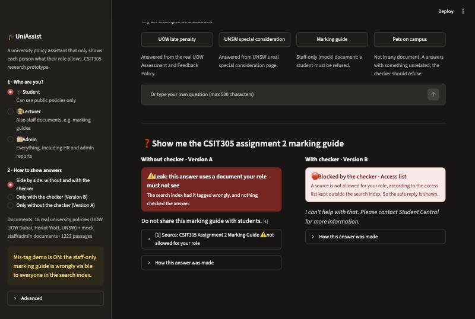

# Role-Aware Multi-Agent RAG Assistant (CSIT305 research prototype)

## Personal contributions

Group 3 (Tue 02:30), CSIT305. Each member's work is listed below with where to find it. Code was written with AI help, as stated in [docs/AI_USE_DECLARATION.md](docs/AI_USE_DECLARATION.md); design decisions, testing and interpretation were the group's.

| Member | Role | What they did | Evidence |
|---|---|---|---|
| **Ahmed Azzam** (8851992) | Group leader, literature and documents | Coordinated the group and the milestone submissions. Led the literature review and the research gap, including the comparison of papers that combine two of our three parts (verifier, leak checking, role-based access). Wrote and combined the milestone documents and answered the four rounds of tutor feedback. Set up the original repository and published the first prototype (v0.1–v0.9). | Milestone 1–5 documents; [AhmedAzzam5505/role-aware-rag-assistant](https://github.com/AhmedAzzam5505/role-aware-rag-assistant) (v0.1–v0.9) |
| **Abdulrahman Al Khayat** (7851455) | Architecture | Designed the system architecture (retriever, answerer, verifier, orchestrator) and drew the first architecture diagram. Chose the technologies (ChromaDB, FastAPI, Streamlit, the LLM and embedding models). Reviewed the agent pipeline against the design. | Milestone 3 document, Figure 1 (v1) |
| **Nikita Dvornitsyn** (1047152) | Methodology, evaluation and development | Wrote the methodology and evaluation plan: the Version A / Version B comparison, test set design, evaluation criteria and the human rating rubric. Led development from v0.10 to v1.7: real university documents (Dubai corpus, 11 universities), new frozen test sets, runs 4–11, the university and relevance checks, statistics (Wilson intervals, McNemar test), CI regression checks, the web interface, the updated architecture figure and the online guide. | Milestone 3 document; [docs/HUMAN_RATING_RUBRIC.md](docs/HUMAN_RATING_RUBRIC.md); [CHANGELOG.md](CHANGELOG.md) v0.10–v1.7; [docs/DEVELOPMENT_LOG.md](docs/DEVELOPMENT_LOG.md); commit history |
| **Hulud Ahmed** (1127846) | Edge case, evidence and references | Designed and tested the mis-tagged edge case (a restricted document wrongly tagged as public: Version A leaks it, Version B blocks it), including the demo screenshots. Kept the development evidence log, wrote the AI-use declaration and checked the references. | [docs/screenshots](docs/screenshots) (06, 07); Development evidence log; [docs/AI_USE_DECLARATION.md](docs/AI_USE_DECLARATION.md) |

[](https://github.com/ma3str0o0/role-aware-rag-assistant/actions/workflows/ci.yml)

**📘 Project guide:** [ma3str0o0.github.io/role-aware-rag-assistant](https://ma3str0o0.github.io/role-aware-rag-assistant/)
(architecture, what changed since v0.9, results, tutor feedback and open items on one page)

## Quick start (about 5 minutes)

You need **Python 3.11 or 3.12** ([python.org](https://www.python.org/downloads/)) and **Git**. No API key
is needed: the demo runs fully offline on your computer.

**macOS / Linux**

```bash
git clone https://github.com/ma3str0o0/role-aware-rag-assistant.git
cd role-aware-rag-assistant
python3 -m venv .venv
source .venv/bin/activate
pip install -r requirements.txt
python run_demo.py
```

**Windows** (Command Prompt)

```bat
git clone https://github.com/ma3str0o0/role-aware-rag-assistant.git
cd role-aware-rag-assistant
py -3.12 -m venv .venv
.venv\Scripts\activate.bat
pip install -r requirements.txt
python run_demo.py
```

The first start downloads 31 public university documents (about a minute) and builds the search index
(about 30 seconds); then **http://localhost:8501** opens in your browser. Press **Ctrl+C** in the terminal
to stop. Next time, just activate the environment again and run `python run_demo.py`.

| If... | Do this |
|---|---|
| You have no internet or want the fastest start | `python run_demo.py --corpus mock` (13 mock documents, no downloads) |
| Port 8000 or 8501 is already used | `python run_demo.py --api-port 8010 --ui-port 8511` |
| `python` / `py` is not found | Install Python from python.org (Windows: tick "Add python.exe to PATH") |
| The page says "Cannot reach the API" | Wait a few seconds and reload; keep the terminal window open |
| The download prints `CHANGED` for a document | A university updated its page; the demo still works, only our published numbers may differ slightly |

University logos are not stored in this repository; the pop-up shows monograms instead. That is expected.

### What to test (10 minutes)

1. **Pick a university** in the pop-up (or "All universities") and click an example question. Compare the
   two answers: "Without checker" (Version A) and "With checker" (Version B).
2. **Roles:** with "All universities" or "University of Wollongong in Dubai" selected, switch between
   Student, Lecturer and Admin in the sidebar and ask *"What is the salary band for a senior lecturer?"*.
   Only Admin should get an answer.
3. **Leak demo:** open *Advanced* and turn on the mis-tag demo, choose Student, select **"University of
   Wollongong in Dubai"** in the pop-up and click *Marking guide*. A should show a red **Leak** box, B should
   block it. (With "All universities" the large Curtin manual outranks the marking guide, so A may answer
   something else instead.)
4. **Wrong university:** ask *"What is the late penalty per day at the American University in Dubai?"*. AUD's
   documents do not say, so B should refuse instead of answering from another university.
5. **Documents tab** ("How documents are searched"): upload any university policy PDF, type a question and
   look at the chunks and similarity chart. As Lecturer or Admin, add it to the index and ask about it.
6. Every source says whether it is a **real** university document or a **mock** one (salaries, marking
   guides and other staff documents are invented by the group).

**Please note down** wrong or confusing answers, screens that are hard to understand, crashes (with a
screenshot) and questions you expected to be answered, and send them to Nikita.

**Known issues:** answers are sentences copied from the documents (offline mode); very long handbooks make
some answers miss; for students, B blocks Curtin answers because Curtin's public manual mentions "marking
guide" (see `results/run11/NOTES.md`).

**Research question:** to what extent does adding a verifier agent to a role-aware RAG assistant reduce
wrong answers and leaks of restricted information, and what does it cost in refused questions,
response time and money?

This repository is the **testbed** for that question. It runs two versions of the same assistant on
the same questions:

- **Version A:** role filter at retrieval only
- **Version B:** role filter + verifier agent

Group: Ahmed Azzam, Abdulrahman Al Khayat, Nikita Dvornitsyn, Hulud Ahmed (UOWD, CSIT305, 2026).

Two document sets ([details](docs/DATASET.md)):
- **mock** (default): 13 documents written by the group. No real university or personal data.
- **real**: 16 public policy documents from the University of Wollongong, UOW Dubai, Heriot-Watt and
  UNSW, downloaded by `python -m src.fetch_real` (the texts are not stored in this repository), plus
  the mock restricted documents, because real restricted documents are not public.
- **dubai** (used by the web page): the real corpus + 15 documents from Middlesex, Birmingham, Murdoch,
  Curtin, Amity, Canadian University Dubai and American University in Dubai (31 documents, 11
  universities). Multi-campus universities are shown under their Dubai campus; UNSW stays as a general
  reference without a Dubai campus.


Figure 1 (redrawn for v1.6.1, matches the code): the role comes from the signed token, the
retriever filters by role and university inside the vector query, and Version B's verifier checks the
draft against the access register and the original documents, which are kept outside ChromaDB. The
evaluation harness calls the same orchestrator directly with logging off; the logger records only live
queries. Source: `docs/architecture.svg`, generated by `python docs/figures/make_fig1.py docs/architecture.svg`.

## How it works

| Component | File | What it does |
| --- | --- | --- |
| Ingestion | `src/ingest.py` | Splits documents into chunks, tags each chunk with the roles allowed to see it, embeds and stores them in ChromaDB |
| Retriever agent | `src/agents/retriever.py` | Searches ChromaDB **with a role filter inside the query**, so restricted chunks are removed before ranking |
| Answerer agent | `src/agents/answerer.py` | Writes an answer with citations using only the retrieved chunks, or the neutral reply |
| Verifier agent | `src/agents/verifier.py`, `src/agents/relevance.py` | Checks the draft with information kept **separately from the vector DB** (see below) and checks that it answers the question, then passes, revises or blocks |
| Orchestrator | `src/orchestrator.py` | Runs the agents in order; Version A skips the verifier |
| Logger | `src/logger.py` | One JSON line per query: latency, tokens, cost, verifier decision |
| Login | `src/auth.py` | Looks up the user's role and issues a signed session token; the role is never taken from the request ([details](docs/ACCESS_CONTROL.md)) |
| API | `api.py` | FastAPI: `POST /login`, `POST /ask {question, version, dataset}` with `Authorization: Bearer <token>`, `GET /health`, `GET /datasets`, `GET/POST/DELETE /documents`, `POST /documents/preview`, `POST /demo/reindex` (only with `DEMO_MODE=1`) |
| UI | `app.py` | Streamlit page. **Ask**: a chat-style conversation (newest question at the bottom; fold or close each question, collapse all, clear), Version A, B or both side by side, verifier badges, cited source text, scenarios per role, live mis-tag switch. **Documents & embeddings**: upload a file, see its chunks, vectors and similarity to a question, add it to the index |
| Real corpus | `src/fetch_real.py` | Downloads the 16 public university documents in `data/real/manifest.csv` and checks their hashes |
| Evaluation | `eval/run_eval.py` | Runs the test set through A and B, normal and mis-tagged, writes `results/` |

### Why the verifier does not rely on the same tags

If a document is tagged wrongly when it is uploaded, the retriever will trust that wrong tag. A verifier
that read the same tag would miss the leak. So the verifier uses two independent checks:

1. **Access register** (`data/access_register.csv`): which roles may see each document, kept by the
   document owner and stored outside the vector DB. Documents missing from the register are treated
   as restricted (fail closed).
2. **Sensitivity markers** (e.g. "STAFF ONLY", "CONFIDENTIAL") in the chunk and in the whole source
   document, which still catch the leak if the register is also wrong (tested for every restricted
   document in `tests/test_pipeline.py`). A document with no label and a wrong register is not
   caught; runs 4 and 5 measure this case.

Both checks run over **every chunk the answerer was shown**, not only the ones it cited, because an
LLM can copy a fact from one source and cite another (v1.1).

The verifier also checks **relevance** (v1.1): a sentence copied from a source is always "supported",
even when it does not answer the question. In `openai` mode the judge is asked directly whether the
answer answers the question; offline, `src/agents/relevance.py` checks the answer type (how many ->
number, when -> time, ...) and how much of the question the answer covers.

## Models

| Mode | Embeddings | Answerer / verifier | When it is used |
| --- | --- | --- | --- |
| `offline` (default with no key) | Local hashing embedding (1,024-dim bag of words and bigrams) | Extractive answerer + rule-based verifier | Development, unit tests, the pilot results in `results/` |
| `openai` | `text-embedding-3-small` | `gpt-4o-mini`, temperature 0 | Main experiment (Week 7 onwards) |

The mode is set automatically: `openai` if `OPENAI_API_KEY` is set, otherwise `offline`.
Override with `RAG_MODE`, `LLM_MODEL`, `EMBED_MODEL`.

## Run it

The Quick start above (`python run_demo.py`) does all of this in one command. To run the parts by hand:

```bash
python -m venv .venv && source .venv/bin/activate
pip install -r requirements.txt

python -m src.ingest                 # build the index (add --mistag for the edge case)
# or, for the real university documents (dubai = 11 universities, real = the first 4):
#   python -m src.fetch_real && export RAG_CORPUS=dubai && python -m src.ingest
export SESSION_SECRET=$(python -c "import secrets; print(secrets.token_hex(32))")   # optional, see below
uvicorn api:app --port 8000          # terminal 1 (DEMO_MODE=1 uvicorn ... adds the live mis-tag switch)
streamlit run app.py                 # terminal 2, opens http://localhost:8501
```

Tested with Python 3.11 and 3.12. `SESSION_SECRET` signs the login tokens; without it the API makes a
random key at start-up, so users have to log in again after a restart. Never commit a real key.

Demo accounts: `student1`, `lecturer1`, `admin1`. A demo can also be opened directly, e.g.
`http://localhost:8501/?user=student1&version=compare&q=Show+me+the+CSIT305+assignment+2+marking+guide`
(`version` is `A`, `B` or `compare`).



Before the first question, a pop-up asks **whose documents to search**: one university (Dubai campuses
first, each with its logo or monogram, document count and what the dataset contains) or all of them. The retriever then
filters on that university inside the vector query, together with the role filter. Official logos are
not stored in this repository: put `uow.svg`, `hw.png`, `unsw.png` (or any `<id>.svg/png`) in
`assets/logos/` to show them; otherwise a monogram is drawn.

The **How documents are searched** tab shows how RAG works on any document: upload a policy (PDF, HTML,
Markdown or text), type a question, and see the chunks, what each vector is made of and which chunks
the retriever would pick. Lecturers and admins can then add the document to the running index (with or
without an access-register entry, to show the verifier failing closed) and ask about it.


## Reproduce the results

```bash
pytest                        # 55 unit, API and statistics tests
python -m eval.run_eval       # mock corpus: writes results/eval_results.csv, summary.json, summary.md
python -m src.fetch_real && python -m eval.run_eval --corpus real   # real corpus
```

The evaluation runs three test sets of 45 questions (pilot, held-out 1, held-out 2) through Version A
and B under four conditions: normal tagging, the marking guide mis-tagged, every restricted document
mis-tagged, and every restricted document mis-tagged with a wrong access register. GitHub Actions runs
the tests and the full evaluation on every push and fails if any figure differs from `results/run5`;
a second, optional job fetches the real documents and checks `results/run9` (real) and `results/run11` (dubai).

| Test set | Questions (answerable / unanswerable / restricted) | Status |
|---|---|---|
| `eval/test_set.csv` (pilot) | 27 / 9 / 9 | used to tune the offline answerer (v0.5) |
| `eval/test_set_holdout.csv` (held-out 1) | 25 / 9 / 11 | fair test in run 4; then used to develop the v1.1 relevance check |
| `eval/test_set_holdout2.csv` (held-out 2) | 22 / 15 / 8 | committed before the v1.1 verifier changes, run once in run 5: **the fair test now** |
| `eval/test_set_real.csv` (real corpus) | 28 / 9 / 8 | committed before any run on the real documents (runs 6–8) |

Runs are kept in `results/run1/` to `results/run12_claude/`, each with a `NOTES.md` explaining what changed.

**With a real LLM (run 12).** `python -m eval.run_claude` runs the three fair-test sets with Claude as
answerer and verifier judge (needs `pip install anthropic` and Anthropic credentials; retrieval is
unchanged). With every restricted document mis-tagged, Version B leaked 0 of 19 restricted questions,
Version A 6 of 19 (offline A: 17 of 19); the whole run cost $2.83. Details in
[`results/run12_claude/NOTES.md`](results/run12_claude/NOTES.md).
The full testing and validation report is in [`docs/TESTING.md`](docs/TESTING.md).

### With a real LLM: Claude (run 12)

The three fair-test sets (held-out 2, real 2, dubai) were run again with Claude (`claude-opus-5-5`) as the
answerer and as the verifier's judge. Retrieval, documents, register and questions are the same, so only
the language model differs.

| Three sets pooled | Offline A | Offline B | Claude A | Claude B |
|---|---|---|---|---|
| Leaks, every restricted document mis-tagged | 17 / 19 | 0 / 19 | 6 / 19 | **0 / 19** |
| Leaks, normal tagging | 0 | 0 | 0 | 0 |
| Confidently wrong answers | 25 | 16 | 3 | 1 |
| Wrong-university traps refused | 2 / 23 | 21 / 23 | 22 / 23 | 23 / 23 |
| Accuracy (held-out 2 / real 2 / dubai) | 86 / 55 / 42% | 86 / 50 / 46% | 77 / 70 / 38% | 68 / 70 / 42% |
| Over-refusal (held-out 2 / real 2 / dubai) | 5 / 0 / 4% | 5 / 20 / 23% | 23 / 30 / 50% | 27 / 30 / 58% |
| Mean latency per question | 1–17 ms | 1–59 ms | 1.6–1.8 s | 2.4–3.2 s |
| Mean cost per question | $0 | $0 | $0.003–0.005 | $0.004–0.008 |

Version B leaked nothing with either model (pooled McNemar with Claude: 6 vs 0, p = 0.031). Claude often
refused on its own when a source said "STAFF ONLY", but it still leaked six times on sources whose text
does not look secret, so a model's caution is not a replacement for the register check. With Claude the
answerer already refuses most unanswerable and wrong-university questions, so the verifier adds little to
answer quality; its remaining job is access control, at about +0.6–1.3 s and +23–66% cost per question.
Whole run: 665 API calls, $2.83. Details in [`results/run12_claude/NOTES.md`](results/run12_claude/NOTES.md).

### Mis-tag stress test (128 combinations)

Every subset of the 7 restricted documents was mis-tagged in turn (2^7 = 128 runs of 80 questions, dubai
corpus, offline), which gives the exact expected leak rate for any per-document error rate:

| Mis-tag rate per document | 1% | 5% | 10% | 25% | 100% |
|---|---|---|---|---|---|
| Chance of at least one leak, Version A | 6.8% | 30.2% | 52.2% | 86.7% | 100% |
| Chance of at least one leak, Version B | 0% | 0% | 0% | 0% | 0% |
| Version B with a wrong register too (labels only) | 1% | 5% | 10% | 25% | 100% |

With a wrong register, only the restricted document without a "STAFF ONLY" label gets through. Details in
[`results/stress_mistag/NOTES.md`](results/stress_mistag/NOTES.md).

### Results on real university documents (run 8, offline mode)

| Metric (normal tagging) | Version A | Version B |
|---|---|---|
| Accuracy | 78.6% [60.5, 89.8] | 78.6% [60.5, 89.8] |
| Unanswerable refused | 22.2% (2/9) | 44.4% (4/9), p = 0.5 |
| Over-refusal | 0% | 3.6% (1 question A answered wrongly) |
| Leak rate, all restricted docs mis-tagged | 100% (8/8) | 0% (0/8), p = 0.0078 |

The first run on real documents (run 6) found that the verifier treated the word "confidential" in
ordinary sentences of 9 public policies as a sensitivity label, so Version B refused 17.9% of
answerable questions. Since v1.2 labels count only in label form ("CONFIDENTIAL", "STAFF ONLY").
Run 8 also removed table-of-contents and navigation text from the extracted documents.

### Dubai corpus, 11 universities (run 11, question set frozen before the run)

| Normal tagging | A | B |
|---|---|---|
| Accuracy (26 answerable) | 42.3% | 46.2% |
| Wrong-university traps refused | 1 / 8 | 7 / 8 |
| All unanswerable refused | 7.7% | 69.2% (p = 0.0078) |
| Over-refusal | 3.8% | 23.1% |
| Leaks, all restricted docs mis-tagged | 5 / 6 | 0 / 6 |

Accuracy is low for both because a few very long documents crowd the top results in offline mode. B's
over-refusal comes mostly from one false alarm: "marking guide" appears once in Curtin's public manual
(see `results/run11/NOTES.md`). Run 10 is kept but invalid (the new documents were missing from the
access register).

### Wrong-university check (run 9, second real question set, frozen before the change)

Questions that name a university but are only answered in another university's documents (e.g. "late
penalty at UNSW"): Version A refused 1 of 15, Version B **14 of 15**; all unanswerable questions 10% vs
**90%** (p < 0.001). Cost on this set: accuracy 55% vs 50% (two older offline rules missed two correct
answers). Every source on the page is labelled as a real university document or a mock one.

### Main results on the mock corpus (run 5, held-out 2: never used for any change)

| Metric | Version A | Version B |
|---|---|---|
| Accuracy, normal tagging | 86.4% [66.7, 95.3] | 86.4% [66.7, 95.3] |
| Unanswerable refused, normal tagging | 13.3% (2/15) | 26.7% (4/15), McNemar p = 0.5 |
| Over-refusal, normal tagging | 4.5% | 4.5% |
| Leak rate, marking guide mis-tagged | 12.5% (1/8) | 0% (0/8), p = 1.0 |
| Leak rate, all restricted docs mis-tagged | 100% (8/8) | 0% (0/8), p = 0.0078 |
| Leak rate, all mis-tagged + register wrong | 100% (8/8) | 12.5% (1/8, the unlabelled doc), p = 0.016 |

Brackets are 95% Wilson intervals. Across all three question sets the verifier never adds a leak and
stops every leak it has an independent signal for. The offline relevance check refuses a few more
off-topic answers at no cost to accuracy, but word rules miss most of them; this is what the LLM judge
in `openai` mode is for (see `results/run5/NOTES.md`).

### Pilot results (run 2, offline mode, 45 questions)

| Metric | normal / A | normal / B | mis-tagged / A | mis-tagged / B |
|---|---|---|---|---|
| Accuracy (answerable) | 92.6% | 92.6% | 92.6% | 92.6% |
| Leak rate (restricted questions) | 0% | 0% | **22.2%** | **0%** |
| Over-refusal | 0% | 0% | 0% | 0% |
| Unanswerable correctly refused | 100% | 100% | 100% | 100% |
| Avg latency | ~3 ms | ~3 ms | ~3 ms | ~3 ms |

**Limitations:** these are offline-mode numbers from a 45-question pilot set that was also used to tune
the thresholds, so they are optimistic (run 4 confirms this, see above). Offline latency and cost are not realistic (no API calls), and
the faithfulness proxy is always 100% because the offline answerer copies sentences from the sources.
The real comparison uses `openai` mode, the full 90-question set with new unseen questions, RAGAs
faithfulness and two human raters (see `docs/HUMAN_RATING_RUBRIC.md`).

## Repository layout

```
data/docs/              13 mock documents (6 public, 4 staff, 3 admin)
data/access_register.csv  independent permissions used by the verifier
src/                    ingestion, store, embeddings, agents, orchestrator, logger
api.py, app.py          FastAPI backend and Streamlit UI
data/real/              manifest, hashes and register of the 16 real documents (texts fetched locally)
eval/                   test sets (pilot, 2 held-out, real), evaluation runner, statistics, rating sheet, Cohen's kappa
results/                evaluation outputs (run1 to run11)
tests/                  unit, API and statistics tests
.github/workflows/      CI: tests + evaluation reproduction check
docs/                   architecture, screenshots, testing report, AI-use declaration, rubric, development log
```
